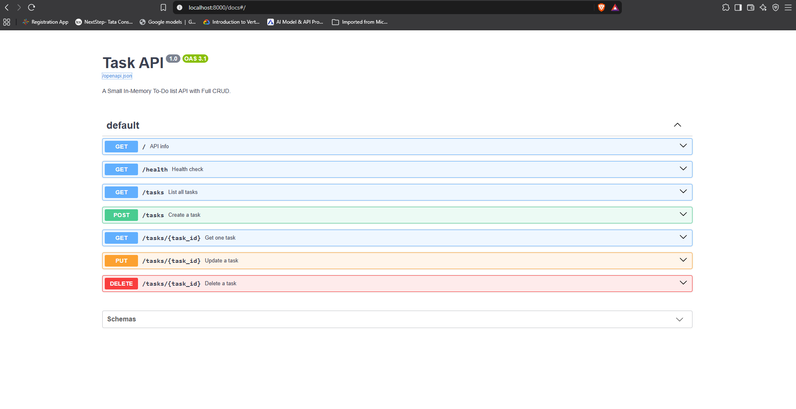

# Task API

A small to-do list API built with [FastAPI](https://fastapi.tiangolo.com/). It supports full CRUD (create, read, update, delete) on tasks.

Data is stored **in memory only** (a Python list), so there is no database and everything resets when the server restarts.

Built for the FlyRank Internship, Backend Track, Week 2, Assignment A1.

## Requirements

- Python 3.10 or higher
- Git (only needed to clone the repo)

## Install & run

```powershell
git clone https://github.com/RPsByteCode/task-api
cd task-api
python -m venv venv
venv\Scripts\Activate.ps1
pip install -r requirements.txt
fastapi dev main.py
```

On macOS/Linux, activate the virtual environment with `source venv/bin/activate` instead.

The server starts at http://localhost:8000.

Interactive Swagger UI documentation is at http://localhost:8000/docs.

## Endpoints

| Method | Path | Description | Success | Errors |
|--------|------|-------------|---------|--------|
| GET | `/` | API info | 200 | none |
| GET | `/health` | Health check | 200 | none |
| GET | `/tasks` | List all tasks | 200 | none |
| GET | `/tasks/{id}` | Get one task | 200 | 404 |
| POST | `/tasks` | Create a task | 201 | 400 |
| PUT | `/tasks/{id}` | Update a task's title and/or done | 200 | 400, 404 |
| DELETE | `/tasks/{id}` | Delete a task | 204 | 404 |

### Task object

```json
{ "id": 1, "title": "Learn HTTP", "done": true }
```

### Validation rules

- `POST /tasks` requires a non-empty string `title`. The server assigns the next free `id` and sets `done` to `false`.
- `PUT /tasks/{id}` accepts `title` (non-empty string) and/or `done` (true or false). An empty body, invalid JSON or wrong types return `400`.
- An unknown task id returns `404`.
- Every error response is JSON in the form `{ "error": "message" }`.

## Example requests

Create a task (PowerShell, piping the JSON avoids quoting problems):

```powershell
'{"title":"Buy milk"}' | curl.exe -i -X POST http://localhost:8000/tasks -H "Content-Type: application/json" --data-binary "@-"
```

Output:

```
HTTP/1.1 201 Created
date: Wed, 30 Sep 2026 14:17:03 GMT
server: uvicorn
content-length: 40
content-type: application/json

{"id":4,"title":"Buy milk","done":false}
```

Other examples:

```powershell
# List all tasks
curl.exe -i http://localhost:8000/tasks

# Get one task
curl.exe -i http://localhost:8000/tasks/1

# Mark task 4 as done
'{"done":true}' | curl.exe -i -X PUT http://localhost:8000/tasks/4 -H "Content-Type: application/json" --data-binary "@-"

# Delete task 4
curl.exe -i -X DELETE http://localhost:8000/tasks/4

# Unknown id returns 404
curl.exe -i http://localhost:8000/tasks/99
```

## Swagger UI



## The mortality experiment

I created a few tasks, restarted the server, and called `GET /tasks` again. Only the 3 original example tasks came back and the tasks I had created were gone. This happens because the tasks live in a Python list in memory, which is wiped when the program stops, and this is exactly the problem a database solves.

## Project structure

```
task-api/
├── main.py            # the whole API
├── requirements.txt   # dependencies
├── docs/
│   └── swagger.png    # Swagger UI screenshot
├── .gitignore
└── README.md
```
